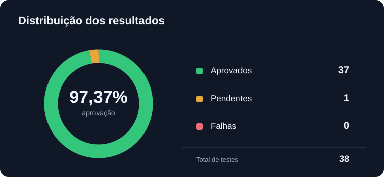
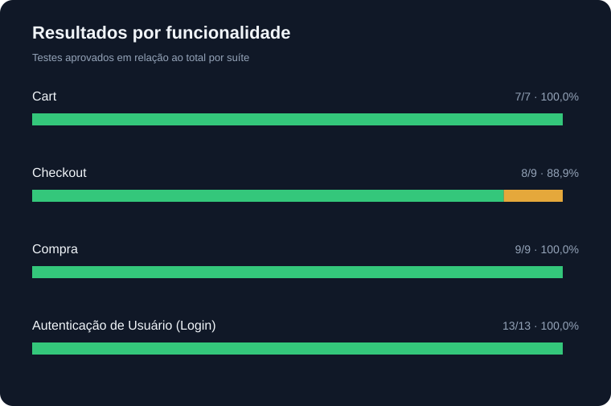

# QA Status Report

**SauceDemo | Cypress E2E Automation**

| Informação                  | Valor                           |
| ----------------------------- | ------------------------------- |
| Projeto                       | SauceDemo                       |
| Tipo de Teste                 | End-to-End (E2E)                |
| Framework                     | Cypress                         |
| Relatório                    | Mochawesome                     |
| Data da Execução            | 27/10/2026                      |
| Status da Execução          | Concluída com testes pendentes |
| Recomendação de Liberação | Não avaliada                   |

<!-- INICIO_CABECALHO -->

| Informação | Valor |
|---|---|
| Projeto | SauceDemo |
| Tipo de Teste | End-to-End (E2E) |
| Framework | Cypress |
| Relatório | Mochawesome |
| Data da Execução | 27/10/2026 |
| Status da Execução | Concluída com testes pendentes |
| Recomendação de Liberação | Não avaliada |

<!-- FIM_CABECALHO -->

---

## 01. Resumo Executivo

<!-- INICIO_RESUMO_EXECUTIVO -->

A execução automatizada registrou **38 casos de teste**, distribuídos entre 4 suítes funcionais.

Foram contabilizados **37 testes aprovados**, **0 falhas** e **1 teste pendente**.

A taxa de aprovação foi de **97,37%**, considerando o total de testes registrados. Esse indicador representa a proporção de testes aprovados em relação ao total, incluindo os pendentes.

Os resultados apresentados refletem exclusivamente as verificações realizadas pelos testes automatizados.

<!-- FIM_RESUMO_EXECUTIVO -->

Permanece uma pendência relacionada à validação de campos no fluxo de checkout. A ausência de falhas não representa, isoladamente, evidência suficiente para recomendar a liberação da aplicação.

## 02. Indicadores de Execução

<!-- INICIO_INDICADORES -->

| Indicador | Resultado |
|---|---:|
| Total de testes | 38 |
| Aprovados | 37 |
| Falhas | 0 |
| Pendentes | 1 |
| Taxa de aprovação | 97,37% |
| Tempo de execução | 28,09 segundos |
| Suítes de testes | 4 |

<!-- FIM_INDICADORES -->

### Distribuição dos Resultados

## 03. Resultados por Funcionalidade

<!-- INICIO_RESULTADOS_FUNCIONALIDADE -->

| Suíte de Testes | Total | Aprovados | Falhas | Pendentes | Taxa de Aprovação |
|---|---:|---:|---:|---:|---:|
| Cart | 7 | 7 | 0 | 0 | 100,00% |
| Checkout | 9 | 8 | 0 | 1 | 88,89% |
| Compra | 9 | 9 | 0 | 0 | 100,00% |
| Autenticação de Usuário (Login) | 13 | 13 | 0 | 0 | 100,00% |
| **Total** | **38** | **37** | **0** | **1** | **97,37%** |

<!-- FIM_RESULTADOS_FUNCIONALIDADE -->

### Escopo dos Testes Automatizados

O escopo automatizado contempla:

- **Autenticação:** autenticação, validações de acesso e encerramento de sessão.
- **Compra:** interações com produtos, ordenação e navegação.
- **Carrinho:** inclusão, remoção, atualização e navegação.
- **Checkout:** preenchimento, validação de dados, finalização e geração de documento PDF.

Os percentuais apresentados representam a aprovação dos testes implementados, não a cobertura integral dos requisitos da aplicação.

## 04. Defeitos e Pendências

**Análise Técnica**

### QA-001 — Validação de Campos no Checkout

| Atributo                        | Descrição                                              |
| ------------------------------- | -------------------------------------------------------- |
| **Módulo**               | Checkout                                                 |
| **Cenário**              | Campos preenchidos exclusivamente com espaços em branco |
| **Situação**            | Pendente de investigação                               |
| **Status da Automação** | Teste desabilitado (`it.skip`)                         |
| **Defeito Confirmado**    | Não                                                     |
| **Impacto no Negócio**   | Ainda não determinado                                   |

O cenário permanece desabilitado até a confirmação da regra de validação aplicável aos campos de checkout.

O comportamento observado requer comparação com critérios de aceite ou especificações funcionais. Até a conclusão dessa análise, não há evidência suficiente para classificar a ocorrência como defeito confirmado.

## 05. Avaliação da Qualidade

### Análise dos Resultados

Os indicadores e gráficos apresentados neste relatório são gerados automaticamente a partir dos resultados registrados pelo Mochawesome.

A avaliação de qualidade deve considerar os resultados da execução, a relevância dos cenários automatizados, as pendências identificadas e os riscos associados às funcionalidades avaliadas.

A aprovação dos testes automatizados indica que as asserções implementadas foram atendidas durante a execução, não representando, isoladamente, garantia de ausência de defeitos.

### Limitações da Avaliação

- A cobertura está limitada aos cenários implementados no projeto.
- Os resultados não comprovam ausência de defeitos em funcionalidades não verificadas.
- Cenários pendentes ou desabilitados exigem análise específica.
- A recomendação de liberação depende de critérios de aceite, avaliação de riscos e análise das pendências.

### Responsabilidade pela Avaliação

A interpretação dos resultados e a decisão sobre a qualidade da aplicação permanecem sob responsabilidade do QA, não sendo determinadas automaticamente pelo percentual de aprovação.

## 06. Avaliação para Liberação

**Recomendação: Não avaliada**

Os resultados da execução automatizada estão apresentados nas seções 02 e 03 deste relatório.

Uma recomendação formal de liberação depende da definição dos critérios de aceite, da avaliação de riscos e da resolução ou aceitação das pendências identificadas.

## 07. Plano de Ação

| ID      | Ação                                                       | Prioridade | Situação |
| ------- | ------------------------------------------------------------ | ---------- | ---------- |
| ACT-001 | Confirmar a regra de validação dos campos do checkout      | Alta       | Pendente   |
| ACT-002 | Revisar o cenário automatizado pendente                     | Média     | Pendente   |
| ACT-003 | Executar regressão após a conclusão da análise do QA-001 | Média     | Planejada  |
| ACT-004 | Revisar os indicadores e a avaliação de QA                 | Média     | Planejada  |

## 08. Informações do Relatório

| Informação                  | Descrição                           |
| ----------------------------- | ------------------------------------- |
| Fonte dos Dados               | `cypress/reports/html/index.json`   |
| Framework de Automação      | Cypress                               |
| Ferramenta de Relatórios     | Mochawesome                           |
| Escopo                        | Testes automatizados End-to-End (E2E) |
| Tipo de Relatório            | Relatório de Status de Execução    |
| Atualização dos Indicadores | Automática                           |
| Atualização dos Gráficos   | Automática                           |
| Avaliação de Qualidade      | Manual, sob responsabilidade do QA    |
| Recomendação de Liberação | Manual, mediante avaliação técnica |

### Processo de Atualização

A execução do comando `npm test` realiza os testes automatizados e, quando um novo relatório JSON é gerado, atualiza os indicadores, os gráficos, o resumo executivo e o cabeçalho do Status Report.

As análises de defeitos, riscos, pendências e recomendações de liberação são mantidas para revisão manual, garantindo a separação entre os resultados técnicos da automação e as decisões de qualidade.
